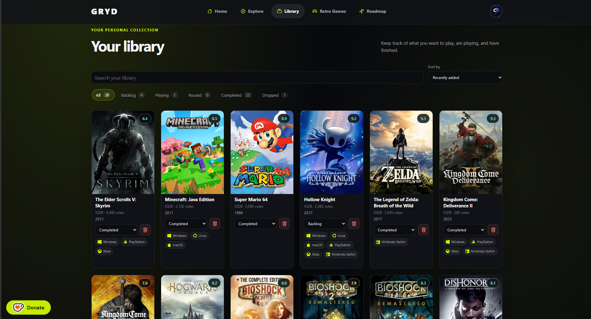
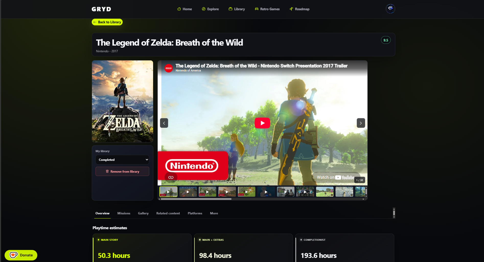

# GRYD

[](https://ko-fi.com/N8X82A3MND)

GRYD is a web application for discovering video games, accessing detailed information, organizing a personal library, and playing retro titles directly from your browser.

The application combines game discovery, tracking, and content into a single interface, with new features being added progressively.

## Screenshots

| Start | Explorer |
|---|---|
|  |  |

| Library | Game details |
|---|---|
|  |  |

## Features

### Explorer

- Video game catalog powered by IGDB data.
- Search by title.
- Filters by genre, theme, platform, and release year.
- Sorting by rating, popularity, and release date.
- Dedicated detail page for each game.
- Covers, screenshots, videos, and related content.
- Platform and release information.
- Playtime estimates through HowLongToBeat.
- Option to hide games that are already part of your personal library.

### Personal Library

Authenticated users can create and organize their own personal game library.

Available statuses:

- Backlog
- Playing
- Paused
- Completed
- Dropped

The library includes search, filtering, and sorting options. A game's status
can also be changed directly from its detail page.

### Game Missions — Beta

Some games include a Missions section with additional information about
missions, objectives, and guides.

This feature is currently in **Beta**, and coverage depends on the game.
Support for additional titles will continue to expand over time.

When compatible content is available, GRYD can display:

- Mission lists.
- Objectives and descriptions.
- Guides associated with each mission.
- Navigation between a mission's guides.
- Images and videos associated with guides.
- Related content accessible directly from the interface.

GRYD checks the Supabase cache first for mission data. When the information
has not yet been stored, GRYD retrieves it on demand and caches it for future
visits.

External content displayed in guides is attributed to its corresponding
source.

### Retro Games

GRYD integrates EmulatorJS to run retro games directly in the browser.

Platforms currently available:

- Nintendo 64
- Super Nintendo
- Game Boy Advance
- Sega Genesis

Supported formats include:

- `.n64`, `.z64`, `.v64`
- `.sfc`, `.smc`
- `.gba`
- `.md`

In addition to the catalog available in GRYD, users can open a compatible ROM
stored on their device using the **Open local game** option.

Retro games and covers can be organized automatically by platform, and the
catalog dynamically generates the corresponding filters.

### PlayStation — In progress

PlayStation support is currently under development.

The implementation is being prepared for:

- PS1 emulation through PCSX-ReARMed.
- Games in `.chd` format.
- S3-compatible external storage for larger games.
- Private buckets accessed through temporary signed URLs.
- Association of externally stored games with covers stored in Supabase.
- Download and loading-time optimization.

External storage integration is optional and can remain disabled until an
S3-compatible storage provider has been configured.

Multi-disc game support is planned as a future extension.

## Project status

| Feature | Status |
|---|---|
| Game Explorer | Available |
| Personal Library | Available |
| Retro Gaming | Available |
| Game Missions | Beta |
| PlayStation Support | In progress |
| Multi-disc Games | Planned |
| Library Insights | Planned |
| User Profiles | Planned |

The application also includes a **Roadmap** section where the current status
of GRYD's main features and upcoming additions can be tracked.

## Retro Games configuration

To enable Retro Games, configure the public `retro-gaming` bucket in Supabase
Storage.

A recommended structure is:

```text
retro-gaming/
├── emulatorjs/
│   └── data/
├── roms/
│   ├── n64/
│   ├── snes/
│   ├── gba/
│   └── genesis/
└── cover/
    ├── n64/
    ├── snes/
    ├── gba/
    └── genesis/
```

The loader must be available at:

```text
emulatorjs/data/loader.js
```

along with the required EmulatorJS files.

Retro game titles are derived from their file names.

To associate a cover with a game, use the same base name for both files.

For example:

```text
roms/snes/Super Mario World.sfc
cover/snes/Super Mario World.webp
```

Covers can use the following formats:

```text
.jpg
.jpeg
.png
.webp
```

Directories placed directly inside `roms/` are treated as platforms and are
used to generate the corresponding catalog filters.

Adding support for another console also requires registering its file
extensions and corresponding EmulatorJS core in the backend configuration.

### External storage

GRYD includes a generic implementation for using S3-compatible storage for
larger games.

The integration is optional and is primarily intended for platforms whose
disc images are too large for the regular retro game storage setup.

The integration uses the following configuration variables:

```dotenv
RETRO_S3_ENDPOINT=
RETRO_S3_REGION=
RETRO_S3_BUCKET=
RETRO_S3_ACCESS_KEY_ID=
RETRO_S3_SECRET_ACCESS_KEY=
```

These credentials are used exclusively by the backend and must never be
exposed to the frontend or committed to the repository.

When external storage is disabled, Retro Games continues to operate using
only the content stored in Supabase.

## Technologies

- **Frontend:** HTML, SCSS/CSS, and vanilla JavaScript.
- **Backend:** Cloudflare Workers.
- **Database and authentication:** Supabase.
- **Storage:** Supabase Storage with optional S3-compatible external storage support.
- **Video game data:** IGDB.
- **Playtime estimates:** HowLongToBeat through Fous.
- **Emulation:** EmulatorJS.
- **PlayStation core under development:** PCSX-ReARMed.

## Project structure

```text
GRYD/
├── frontend/
│   ├── assets/
│   │   ├── fonts/
│   │   └── images/
│   ├── index.html
│   ├── legal/
│   ├── styles/
│   │   ├── css/
│   │   └── scss/
│   └── js/
│       ├── app/
│       └── features/
├── functions/                 # Pages Functions for /api/... routes
├── backend/
│   ├── worker.mjs
│   └── src/
│       ├── constants/
│       ├── routes/
│       └── services/
├── docs/
│   ├── images/
│   ├── DEVELOPMENT-COMMANDS.md
│   ├── ROADMAP.md
│   └── SCHEMA.md
├── supabase/                  # SQL for tables and caches
├── package.json
└── wrangler.jsonc
```

Images and fonts used by the interface are located in:

```text
frontend/assets/images/
frontend/assets/fonts/
```

Screenshots used in this README are stored in:

```text
docs/images/
```

## Local development

### Requirements

- Node.js and npm.
- A Supabase project.
- IGDB credentials.
- A Fous API key for HowLongToBeat estimates.
- Optionally, an S3-compatible provider for external retro game storage.

### Installation

Install the dependencies:

```bash
npm install
```

Create a `.dev.vars` file in the project root with the variables used by
Wrangler:

```dotenv
SUPABASE_URL=
SUPABASE_PUBLISHABLE_KEY=
SUPABASE_SECRET_KEY=

IGDB_CLIENT_ID=
IGDB_ACCESS_TOKEN=

FOUS_API_KEY=
```

If external retro storage is enabled, also add:

```dotenv
RETRO_S3_ENDPOINT=
RETRO_S3_REGION=
RETRO_S3_BUCKET=
RETRO_S3_ACCESS_KEY_ID=
RETRO_S3_SECRET_ACCESS_KEY=
```

`.dev.vars` is excluded from the repository and must never be committed to Git.

Before running GRYD for the first time, apply the required Supabase schema:

```text
supabase/create_games.sql
```

To enable Game Missions, also apply:

```text
supabase/create_game_missions.sql
```

## Game Missions

Missions and guides are loaded on demand.

GRYD first checks the `game_missions` table. If the requested information is
not already stored, it is retrieved when the user accesses the corresponding
content and is then cached in Supabase.

Each mission can include multiple guide pages. Guide content is retrieved when
a guide is opened and displayed in a dedicated view with sidebar navigation.

Guides can include:

- Text.
- Images.
- Videos.
- Links to related content.

Game slugs are resolved using the available IGDB data, and common title
variations are tested when necessary to locate related content.

The interface displays the corresponding attribution for content obtained from
external sources.

## Running the project

Start the frontend and Worker together:

```bash
npm run dev
```

This command:

1. Compiles the SCSS.
2. Starts the Cloudflare Worker.
3. Starts the frontend development server.

During local development, they are normally available at:

```text
Frontend: http://localhost:3000
Worker:   http://localhost:8787
```

To compile only the styles:

```bash
npm run build:css
```

This generates:

```text
frontend/styles/css/main.css
```

from:

```text
frontend/styles/scss/main.scss
```

Styles should therefore be modified in the SCSS source files rather than
directly in `main.css`.

## Supabase Auth and email

GRYD uses Supabase Auth for user registration and authentication.

Email confirmation can be enabled in Supabase.

When enabled, users must open the link received by email to confirm their
account. When disabled, registration can automatically start a user session.

For production, configure:

**Authentication → URL Configuration**

including the appropriate **Site URL** and **Redirect URLs**.

If email confirmation is enabled, also review:

**Authentication → Email Templates → Confirm signup**

so that confirmation links redirect back to GRYD using `token_hash` and
`type=email`.

For reliable email delivery in production, configuring a dedicated SMTP server
is recommended.

Detailed configuration is available in:

[Development commands and configuration](docs/DEVELOPMENT-COMMANDS.md)

## Deployment

The backend is deployed using Cloudflare Workers and the frontend using
Cloudflare Pages.

Secret configuration, authentication, deployment commands, and verification
steps are documented in:

[Development and deployment guide](docs/DEVELOPMENT-COMMANDS.md)

## Documentation

- [Commands, APIs, and deployment](docs/DEVELOPMENT-COMMANDS.md)
- [Supabase schema](docs/SCHEMA.md)
- [Roadmap](docs/ROADMAP.md)

## Credits

- Video game catalog data is provided by IGDB.
- Playtime estimates use HowLongToBeat data.
- Retro system emulation is provided through EmulatorJS and the corresponding emulator cores.
- Mission and guide content displays attribution to its corresponding source.
- The Geist Pixel typeface is distributed under the SIL Open Font License 1.1; its license is included alongside the font files.