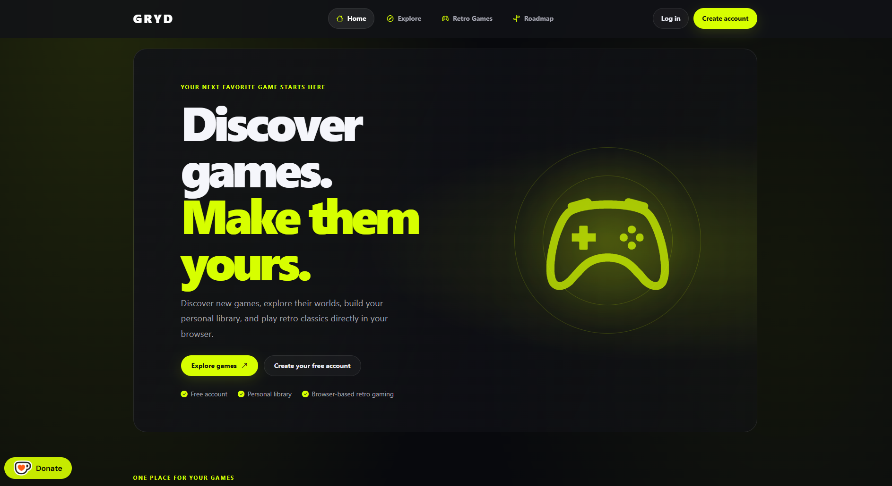
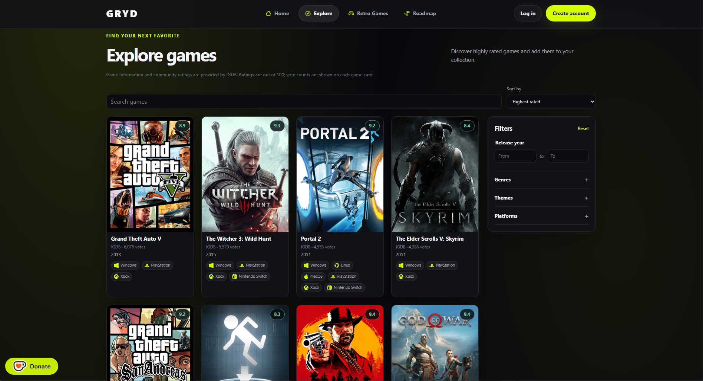

# GRYD

[](https://ko-fi.com/N8X82A3MND)

GRYD es una aplicación web para descubrir videojuegos, consultar información detallada, organizar una biblioteca personal y jugar a títulos retro directamente desde el navegador.

La aplicación combina descubrimiento, seguimiento y contenido de videojuegos en una única interfaz, con nuevas funcionalidades incorporándose de forma progresiva.

## Capturas

| Inicio | Explorer |
|---|---|
|  |  |

| Biblioteca | Detalle de un juego |
|---|---|
|  |  |

## Funcionalidades

### Explorer

- Catálogo de videojuegos con datos de IGDB.
- Búsqueda por nombre.
- Filtros por género, tema, plataforma y año de lanzamiento.
- Ordenación por valoración, popularidad y fecha de lanzamiento.
- Página de detalle para cada juego.
- Portadas, capturas, vídeos y contenido relacionado.
- Información sobre plataformas y lanzamientos.
- Estimaciones de duración mediante HowLongToBeat.
- Posibilidad de ocultar juegos que ya forman parte de la biblioteca personal.

### Personal Library

Los usuarios autenticados pueden crear y organizar su propia biblioteca de
videojuegos.

Estados disponibles:

- Backlog
- Playing
- Paused
- Completed
- Dropped

La biblioteca incluye búsqueda, filtros y ordenación. El estado de un juego
también puede modificarse directamente desde su página de detalle.

### Game Missions — Beta

Algunos juegos incluyen una sección de misiones con información adicional
sobre objetivos, misiones y guías.

La funcionalidad se encuentra actualmente en **Beta** y su cobertura depende
del título. El número de juegos compatibles continuará ampliándose
progresivamente.

Cuando existe contenido compatible, GRYD puede mostrar:

- Listas de misiones.
- Objetivos y descripciones.
- Guías asociadas a cada misión.
- Navegación entre las guías de una misión.
- Imágenes y vídeos asociados a las guías.
- Contenido relacionado accesible desde la propia interfaz.

Las misiones se consultan primero en la caché de Supabase. Cuando todavía no
están almacenadas, GRYD obtiene la información bajo demanda y la guarda para
reutilizarla en futuras visitas.

El contenido externo mostrado en las guías se atribuye a su fuente
correspondiente.

### Retro Games

GRYD integra EmulatorJS para ejecutar juegos retro directamente desde el
navegador.

Plataformas disponibles actualmente:

- Nintendo 64
- Super Nintendo
- Game Boy Advance
- Sega Genesis

Entre los formatos soportados se encuentran:

- `.n64`, `.z64`, `.v64`
- `.sfc`, `.smc`
- `.gba`
- `.md`

Además del catálogo disponible en GRYD, es posible abrir una ROM compatible
almacenada en el dispositivo mediante la opción **Open local game**.

Los juegos retro y las portadas pueden organizarse automáticamente por
plataforma y el catálogo genera dinámicamente sus filtros.

### PlayStation — In progress

El soporte para PlayStation está actualmente en desarrollo.

La implementación está siendo preparada para:

- Emulación de PS1 mediante PCSX-ReARMed.
- Juegos en formato `.chd`.
- Almacenamiento externo S3-compatible para juegos de mayor tamaño.
- Buckets privados mediante URLs temporales firmadas.
- Asociación de los juegos externos con portadas almacenadas en Supabase.
- Optimización de los tiempos de descarga y carga.

La integración de almacenamiento externo es opcional y puede mantenerse
desactivada hasta disponer de un proveedor S3-compatible configurado.

El soporte para juegos multidisco está previsto como una ampliación futura.

## Estado del proyecto

| Funcionalidad | Estado |
|---|---|
| Game Explorer | Available |
| Personal Library | Available |
| Retro Gaming | Available |
| Game Missions | Beta |
| PlayStation Support | In progress |
| Multi-disc Games | Planned |
| Library Insights | Planned |
| User Profiles | Planned |

La aplicación también incluye una sección **Roadmap** donde se muestra el
estado de las principales funcionalidades y las próximas incorporaciones.

## Configuración de Retro Games

Para habilitar Retro Games, configura el bucket público `retro-gaming` en
Supabase Storage.

Una estructura recomendada es:

```text
retro-gaming/
├── emulatorjs/
│   └── data/
├── roms/
│   ├── n64/
│   ├── snes/
│   ├── gba/
│   └── genesis/
└── cover/
    ├── n64/
    ├── snes/
    ├── gba/
    └── genesis/
```

El loader debe estar disponible en:

```text
emulatorjs/data/loader.js
```

junto con los archivos necesarios de EmulatorJS.

Los títulos del catálogo retro se obtienen del nombre de los archivos.

Para asociar una portada con un juego, utiliza el mismo nombre base para ambos
archivos.

Por ejemplo:

```text
roms/snes/Super Mario World.sfc
cover/snes/Super Mario World.webp
```

Las portadas pueden utilizar los formatos:

```text
.jpg
.jpeg
.png
.webp
```

Las subcarpetas situadas directamente dentro de `roms/` se utilizan como
plataformas y permiten generar los filtros correspondientes del catálogo.

Para reproducir una consola nueva también es necesario registrar sus
extensiones y el core correspondiente de EmulatorJS en la configuración del
backend.

### Almacenamiento externo

GRYD dispone de una implementación genérica para utilizar almacenamiento
S3-compatible con juegos de mayor tamaño.

La integración es opcional y está pensada principalmente para plataformas
cuyas imágenes de disco resultan demasiado grandes para el almacenamiento
retro habitual.

La configuración utiliza las siguientes variables:

```dotenv
RETRO_S3_ENDPOINT=
RETRO_S3_REGION=
RETRO_S3_BUCKET=
RETRO_S3_ACCESS_KEY_ID=
RETRO_S3_SECRET_ACCESS_KEY=
```

Las credenciales se utilizan únicamente en el backend y nunca deben exponerse
en el frontend o añadirse al repositorio.

Cuando el almacenamiento externo está desactivado, Retro Games continúa
funcionando únicamente con el contenido almacenado en Supabase.

## Tecnologías

- **Frontend:** HTML, SCSS/CSS y JavaScript sin framework.
- **Backend:** Cloudflare Workers.
- **Base de datos y autenticación:** Supabase.
- **Almacenamiento:** Supabase Storage y soporte opcional para almacenamiento S3-compatible.
- **Datos de videojuegos:** IGDB.
- **Duración estimada:** HowLongToBeat, a través de Fous.
- **Emulación:** EmulatorJS.
- **Core de PlayStation en desarrollo:** PCSX-ReARMed.

## Estructura del proyecto

```text
GRYD/
├── frontend/
│   ├── assets/
│   │   ├── fonts/
│   │   └── images/
│   ├── index.html
│   ├── legal/
│   ├── styles/
│   │   ├── css/
│   │   └── scss/
│   └── js/
│       ├── app/
│       └── features/
├── functions/                 # Pages Functions para las rutas /api/...
├── backend/
│   ├── worker.mjs
│   └── src/
│       ├── constants/
│       ├── routes/
│       └── services/
├── docs/
│   ├── images/
│   ├── DEVELOPMENT-COMMANDS.md
│   ├── ROADMAP.md
│   └── SCHEMA.md
├── supabase/                  # SQL de tablas y caché
├── package.json
└── wrangler.jsonc
```

Las imágenes y fuentes utilizadas por la interfaz se encuentran en:

```text
frontend/assets/images/
frontend/assets/fonts/
```

Las capturas utilizadas en este README se almacenan en:

```text
docs/images/
```

## Desarrollo local

### Requisitos

- Node.js y npm.
- Un proyecto de Supabase.
- Credenciales de IGDB.
- Una clave de Fous para las estimaciones de HowLongToBeat.
- Opcionalmente, un proveedor S3-compatible para almacenamiento retro externo.

### Instalación

Instala las dependencias:

```bash
npm install
```

Crea `.dev.vars` en la raíz del proyecto con las variables utilizadas por
Wrangler:

```dotenv
SUPABASE_URL=
SUPABASE_PUBLISHABLE_KEY=
SUPABASE_SECRET_KEY=

IGDB_CLIENT_ID=
IGDB_ACCESS_TOKEN=

FOUS_API_KEY=
```

Si habilitas el almacenamiento retro externo, añade también:

```dotenv
RETRO_S3_ENDPOINT=
RETRO_S3_REGION=
RETRO_S3_BUCKET=
RETRO_S3_ACCESS_KEY_ID=
RETRO_S3_SECRET_ACCESS_KEY=
```

`.dev.vars` está excluido del repositorio y no debe añadirse a Git.

Antes de ejecutar GRYD por primera vez, aplica el esquema necesario de
Supabase:

```text
supabase/create_games.sql
```

Para habilitar Game Missions, aplica también:

```text
supabase/create_game_missions.sql
```

## Game Missions

Las misiones y guías se cargan bajo demanda.

GRYD consulta primero la tabla `game_missions`. Si la información todavía no
está almacenada, se obtiene cuando el usuario accede al contenido
correspondiente y posteriormente se guarda en Supabase.

Cada misión puede incluir diferentes guide pages. El contenido de cada guía se
consulta al abrirla y se presenta mediante una vista dedicada con navegación
lateral.

Las guías pueden incluir:

- Texto.
- Imágenes.
- Vídeos.
- Enlaces a contenido relacionado.

Los slugs de los juegos se resuelven utilizando los datos disponibles en IGDB
y se prueban variantes habituales de los títulos cuando es necesario localizar
contenido relacionado.

La interfaz muestra la atribución correspondiente para el contenido procedente
de fuentes externas.

## Ejecutar el proyecto

Inicia simultáneamente el frontend y el Worker:

```bash
npm run dev
```

Este comando:

1. Compila el SCSS.
2. Inicia el Cloudflare Worker.
3. Inicia el servidor del frontend.

En desarrollo local normalmente estarán disponibles en:

```text
Frontend: http://localhost:3000
Worker:   http://localhost:8787
```

Para compilar únicamente los estilos:

```bash
npm run build:css
```

El comando genera:

```text
frontend/styles/css/main.css
```

a partir de:

```text
frontend/styles/scss/main.scss
```

Por tanto, los estilos deben modificarse en los archivos SCSS y no directamente
en `main.css`.

## Supabase Auth y correo

GRYD utiliza Supabase Auth para el registro y autenticación de usuarios.

La confirmación de correo puede activarse desde Supabase.

Si está activada, el usuario debe abrir el enlace recibido por correo para
confirmar la cuenta. Si está desactivada, el registro puede iniciar la sesión
automáticamente.

Para producción, configura:

**Authentication → URL Configuration**

incluyendo la **Site URL** y las **Redirect URLs** correspondientes.

Si utilizas confirmación de correo, revisa también:

**Authentication → Email Templates → Confirm signup**

para que el enlace redirija correctamente a GRYD utilizando `token_hash` y
`type=email`.

Para una entrega de correo fiable en producción es recomendable configurar un
servidor SMTP propio.

La configuración detallada se encuentra en:

[Comandos y configuración](docs/DEVELOPMENT-COMMANDS.md)

## Despliegue

El backend se publica mediante Cloudflare Workers y el frontend mediante
Cloudflare Pages.

La configuración de secretos, autenticación, despliegue y comandos de
verificación se encuentra documentada en:

[Guía de comandos de desarrollo y despliegue](docs/DEVELOPMENT-COMMANDS.md)

## Documentación

- [Comandos, APIs y despliegue](docs/DEVELOPMENT-COMMANDS.md)
- [Esquema de Supabase](docs/SCHEMA.md)
- [Roadmap](docs/ROADMAP.md)

## Créditos

- Los datos del catálogo de videojuegos proceden de IGDB.
- Las estimaciones de duración utilizan datos de HowLongToBeat.
- La emulación de sistemas retro se realiza mediante EmulatorJS y los cores correspondientes.
- El contenido de misiones y guías muestra su atribución a la fuente correspondiente.
- La tipografía Geist Pixel se distribuye bajo la SIL Open Font License 1.1; su licencia se incluye con los archivos de fuente.