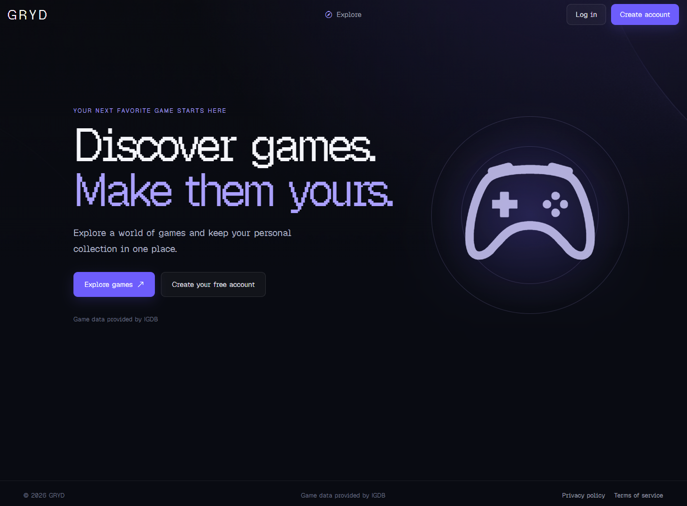
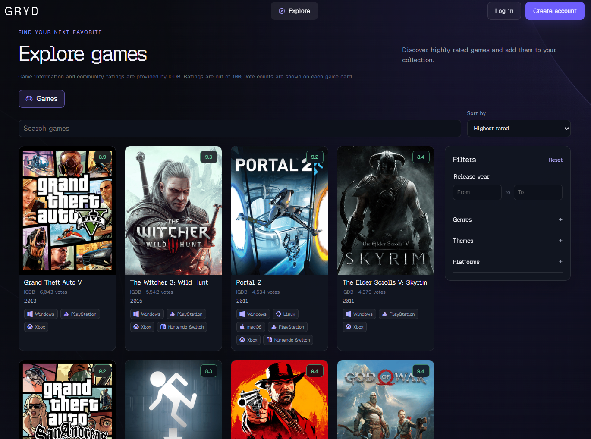
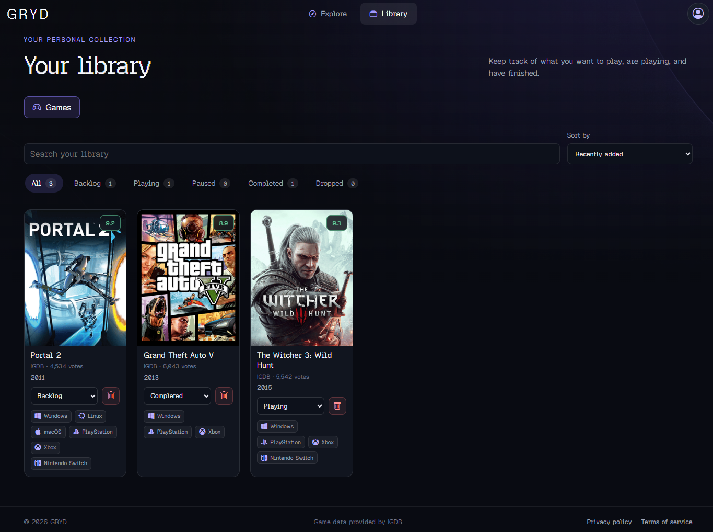
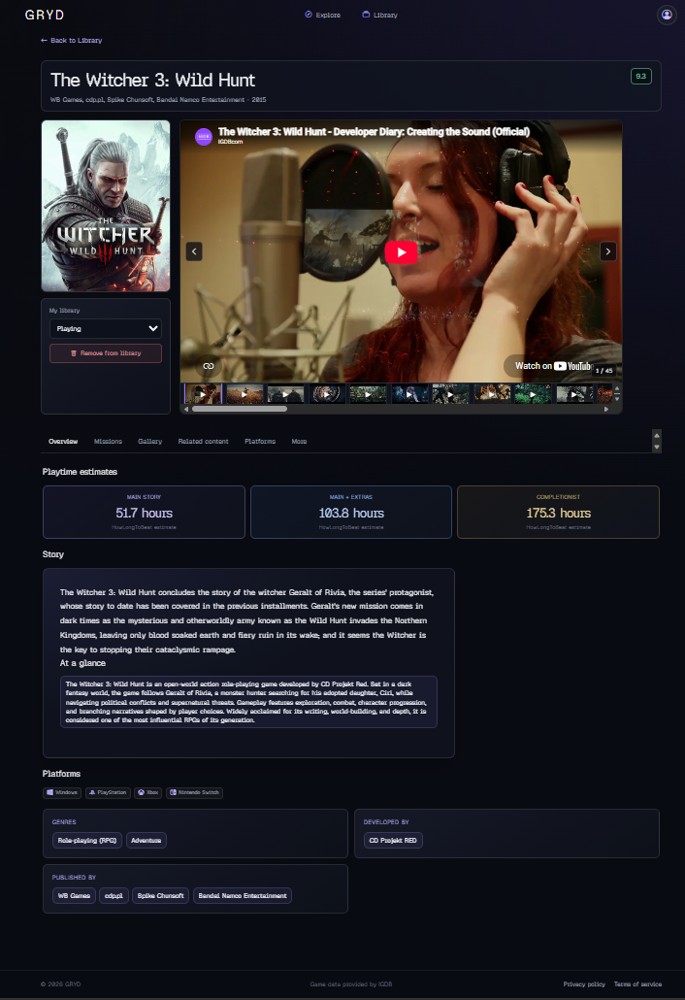

# GRYD

[](https://ko-fi.com/N8X82A3MND)

GRYD es una aplicación para descubrir videojuegos, consultar sus detalles y
mantener una biblioteca personal organizada por estado.

## Capturas

| Inicio | Explorer |
|---|---|
|  |  |

| Biblioteca | Detalle de un juego |
|---|---|
|  |  |

## Funcionalidades

- Catálogo de IGDB con búsqueda, filtros por género, tema, plataforma y año, y
  opciones de ordenación.
- Página de detalle por juego con medios, información editorial y estimaciones
  de duración de HowLongToBeat.
- Biblioteca personal con estados, búsqueda, filtros y ordenación.
- Catálogo retro con reproducción de juegos de Nintendo 64 mediante EmulatorJS
  y archivos servidos desde Supabase Storage.
- Autenticación con Supabase, perfil, carga de avatar y gestión de cuenta.
- Caché compartida en Supabase para los datos de juegos y las estimaciones de
  duración.

Para habilitar Retro Games, configura el bucket público `retro-gaming` en
Supabase Storage. El loader debe estar en `emulatorjs/data/loader.js` junto con
los archivos `data` de EmulatorJS, y los juegos de Nintendo 64 (`.n64`, `.z64`
o `.v64`) deben estar dentro de `roms/`. Para mostrar una portada, añade a
`cover/` una imagen `.jpg`, `.jpeg`, `.png` o `.webp` con el mismo nombre base
que la ROM (por ejemplo, `roms/Game.n64` y `cover/Game.webp`). Se admiten
subcarpetas; los títulos se obtienen de los nombres de archivo.

## Tecnologías

- **Frontend:** HTML, SCSS/CSS y JavaScript sin framework.
- **Backend:** Express en Cloudflare Workers.
- **Base de datos y autenticación:** Supabase.
- **Datos de videojuegos:** IGDB.
- **Duración estimada:** HowLongToBeat, a través de Fous.

## Estructura del proyecto

```text
GRYD/
├── frontend/
│   ├── assets/
│   │   ├── fonts/
│   │   └── images/
│   ├── index.html
│   ├── legal/
│   ├── styles/
│   │   ├── css/
│   │   └── scss/
│   └── js/
├── functions/                 # Pages Functions para las rutas /api/...
├── backend/
│   ├── worker.mjs
│   └── src/
│       ├── constants/
│       ├── routes/
│       └── services/
├── docs/
│   ├── images/
│   ├── DEVELOPMENT-COMMANDS.md
│   ├── ROADMAP.md
│   └── SCHEMA.md
├── supabase/                  # SQL de tablas y caché
├── package.json
└── wrangler.jsonc
```

Las imágenes de interfaz y la fuente local se sirven desde
`frontend/assets/images/` y `frontend/assets/fonts/`. Las capturas del README
están en `docs/images/`.

## Desarrollo local

### Requisitos

- Node.js y npm.
- Un proyecto de Supabase con sus credenciales.
- Credenciales de IGDB y una clave de Fous para consultar HowLongToBeat.

### Instalación

```bash
npm install
```

Crea `.dev.vars` en la raíz del proyecto con las variables requeridas por
Wrangler. El archivo está excluido de Git:

```dotenv
SUPABASE_URL=
SUPABASE_PUBLISHABLE_KEY=
SUPABASE_SECRET_KEY=
IGDB_CLIENT_ID=
IGDB_ACCESS_TOKEN=
FOUS_API_KEY=
```

No compartas ni añadas este archivo al repositorio. Antes de ejecutar la nueva
caché por primera vez, asegúrate de haber aplicado el SQL
[supabase/create_games.sql](supabase/create_games.sql) en el proyecto Supabase.
Para habilitar el tab Missions, aplica también
[supabase/create_game_missions.sql](supabase/create_game_missions.sql).
Las checklist y guías de IGN se cargan bajo demanda desde ese tab: las tareas
se consultan primero en `game_missions` y, si aún no están guardadas, se
obtienen al desplegar cada sección. Cada misión despliega sus guide pages;
el contenido se consulta al abrir una guía y se muestra en una vista propia,
con un menú lateral para cambiar entre las guías de esa misión. Los datos
obtenidos se guardan en la misma tabla para reutilizarlos en visitas posteriores.
Las guías incluyen las imágenes y vídeos de IGN y los guardan junto al
contenido. Los enlaces a otras páginas de IGN también se cargan y abren dentro
de GRYD.
Los slugs se resuelven desde IGDB y se prueban variantes habituales de
numeración romana/arábiga para encontrar la ruta de IGN. La interfaz atribuye
el contenido a IGN.

Inicia el frontend y el Worker:

```bash
npm run dev
```

El frontend suele estar disponible en `http://localhost:3000` y el Worker en
`http://localhost:8787`. `npm run dev` compila el CSS antes de iniciar ambos.
Para compilar solo los estilos:

```bash
npm run build:css
```

## Supabase Auth y correo

La confirmación de correo se puede activar en Supabase. Si está activada, el
usuario debe abrir el enlace enviado para terminar de confirmar la cuenta; si
está desactivada, el registro inicia sesión automáticamente.

Para producción, configura la **Site URL** y las **Redirect URLs** en
**Authentication → URL Configuration**. Si habilitas la confirmación, ajusta la
plantilla **Authentication → Email Templates → Confirm signup** para que el
enlace apunte a la página de GRYD con `token_hash` y `type=email`, como se
describe en la guía de [comandos y configuración](docs/DEVELOPMENT-COMMANDS.md).
Configura un SMTP propio para entregar correo de forma fiable.

## Despliegue

El backend se publica como Cloudflare Worker y el frontend como Cloudflare
Pages. Los pasos de autenticación, configuración de secretos, publicación y
consultas `curl` están en la
[guía de comandos de desarrollo y despliegue](docs/DEVELOPMENT-COMMANDS.md).

## Documentación

- [Comandos, APIs y despliegue](docs/DEVELOPMENT-COMMANDS.md)
- [Esquema de Supabase](docs/SCHEMA.md)
- [Roadmap](docs/ROADMAP.md)

## Créditos

- Los datos del catálogo de videojuegos proceden de IGDB.
- La tipografía Geist Pixel se distribuye bajo SIL Open Font License 1.1; su
  licencia se incluye con los archivos de fuente.
